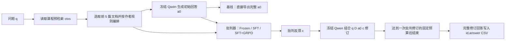
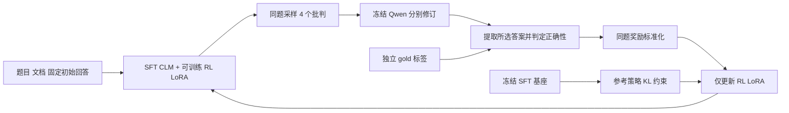
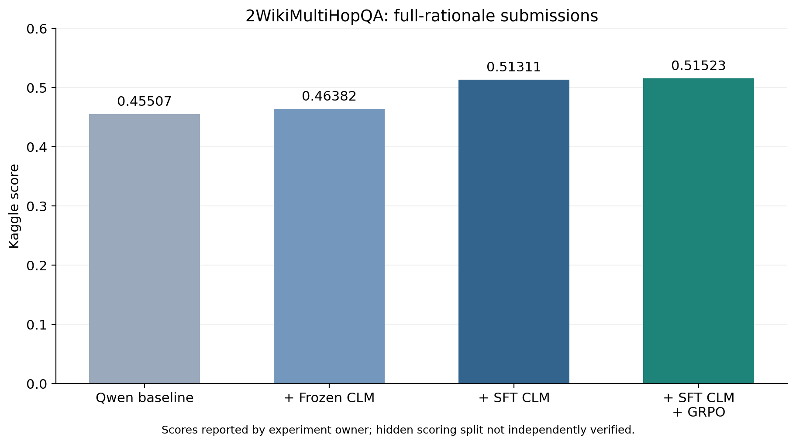

# 基于批判模型与 GRPO 的 RAG 问答改进：实现与实验说明

本文用于课程报告与 PPT 写作，依据本项目代码、下载的服务器报告以及执行者提供的四组 Kaggle 成绩整理。写作时应保留“已实现”“由日志验证”“由执行者提供”“未来可扩展”之间的区别。统计源文件见 [verified_training_summary.json](../results/verified_training_summary.json) 和 [kaggle_scores.json](../results/kaggle_scores.json)。

## 1. 可以直接用于报告的摘要

本项目研究检索增强问答中，如何利用独立批判模型发现并修正回答的推理错误和幻觉。固定 Qwen2.5-7B-Instruct 为回答模型，在课程版 2WikiMultiHopQA 的 12,576 个测试问题上比较四种设置：直接使用检索文档回答、使用未经本项目微调的 LLaMA-3.1-8B-Instruct 提供批判、使用监督微调的 CLM8B 提供批判，以及在 CLM8B 上继续进行小规模 GRPO 后提供批判。监督训练使用来自五个问答数据集的 10K 重构训练样本，GRPO 使用独立的 128 个训练问题和 128 个开发问题。四组完整回答提交的 Kaggle 分数分别为 0.45507、0.46382、0.51311、0.51523。监督微调组相对基线提高 5.804 个百分点，GRPO 在监督微调组基础上进一步提高 0.212 个百分点。结果表明，在本次课程评测中，经训练的批判模型比直接使用原版批判模型取得更高分数；强化学习带来小幅增益，但其稳定性仍需在一致推理配置和多随机种子下进一步检验。

关键词：检索增强生成；批判语言模型；多跳问答；LoRA；GRPO；大模型幻觉。

## 2. 问题定义与四组实验

一个多跳问题可能要求先识别作品作者，再查作者的出生地。文档检索命中其中一跳，不意味着模型能正确连接所有实体关系。模型可能选错同名实体、忽略证据缺口，或者在长回答中给出自相矛盾的结论。

令问题为 $q$，预检索文档为 $D$，回答模型为 $G$，批判模型为 $C$。本项目研究的是：保持回答模型与初始回答不变，改进批判反馈能否改善最后的回答？

| 名称 | 初始回答 | 批判器状态 | 最终提交 |
| --- | --- | --- | --- |
| Qwen 基线 | $a_0=G(q,D)$ | 无 | $a_0$ 完整文本 |
| Frozen CLM | 同一份 $a_0$ | 原版 LLaMA，冻结 | $a_1=G(q,D,a_0,C(q,D,a_0))$ |
| SFT CLM | 同一份 $a_0$ | 先做批判任务 SFT，评测时冻结 | $a_1$ 完整文本 |
| SFT CLM + GRPO | 同一份 $a_0$ | SFT 基座上新增 RL LoRA，评测时冻结 | $a_1$ 完整文本 |

第二组必须称为 **Frozen CLM**。原版 Instruct 模型本身当然经历过其发布者的训练，但本项目没有在第二组中额外训练它。第三组才是本项目完成批判数据监督微调的 CLM8B。

“CLM8B”指约 8B 规模的批判语言模型，不是另外下载的一种模型架构。这里的 CLM 也不是 Actor–Critic 算法中预测价值的 value critic；在 GRPO 阶段，生成批判文本的 CLM 本身就是要优化的策略。

## 3. 实际实现的端到端流程

### 3.1 流程图



### 3.2 文档检索：使用提供的检索结果

课程 `test.json` 每条包含 `question`、`id` 和 `ctxs`，上下文通常有 10 个候选。当前四组代码直接使用已经给出的检索结果，没有重新训练检索器、构建 FAISS 索引或在线搜索维基百科。

`pipelines/qwen/eval/inference_vllm.py` 先将 `score` 的字符串转换为浮点数。`data_utils.py::build_contexts()` 取前 5 篇：如果前两篇的分数表现为降序，则将这 5 篇逆序编排；否则保留原顺序。格式为 `Document i (Title: ...): ...`。这是沿用作者的文档编排习惯，不是本项目新训练的重排序器。

因此报告中可写“利用预检索文档进行 RAG”，不宜写“本项目训练了检索模型”。本项目不改变原始 top-5 集合，批判之后也不增加新的检索轮次。

### 3.3 初始回答：phase 1

回答模型为 Qwen2.5-7B-Instruct。系统提示给出问题与文档，用户提示要求识别有用文档并解释文档内容如何导向答案。输出是一段带推理过程的完整回答，保存为 `result_rationale_cot.json`。

记录的 `answers` 字段来自数据集标准答案，而不是模型的短答案字段。课程测试集未提供标准答案，所以 `answers: null` 不表示模型答错，也不表示准确率为零。模型文本位于 `rationale`。

后续三组均读取同一份已经完成的全量初始回答。这避免把“重新采样 Qwen 初始回答带来的变化”混进批判模型对比。新机器重新生成基线时，也必须让后三组共同指向那一份新基线。

### 3.4 批判反馈：phase 2

输入包括 $q,D,a_0$。提示要求批判器指出弱回答中的问题和幻觉，并提出建设性的修正意见。测试时没有提供标准答案或强模型参考回答。

三个批判器输入相同，仅权重状态不同：原版 LLaMA、SFT 后的 LLaMA、SFT 基座加 RL 适配器。生成的反馈保存为 `result_critic_rationale_cot.json`，其 `rationale` 在这一阶段表示批判文本。

### 3.5 回答修正：phase 3

Qwen 接收原问题、相同文档、原始回答和批判意见，生成改进后的回答，保存为 `result_refine_cot.json`。Qwen 的参数不更新。最终 CSV 使用的是这一步的回答，而不是批判器的文本。

伪代码如下：

```python
for item in course_test:
    documents = format_author_top5(item["ctxs"])
    initial = cached_qwen_answer[item["id"]]
    critique = critic(question=item["question"], documents=documents, rationale=initial)
    revised = qwen(question=item["question"], documents=documents,
                   rationale=initial, critique=critique)
    save(id=item["id"], answer=revised)  # 完整文本
```

实际代码为批量推理，并将批判与修订放在独立进程中依次运行，以释放 GPU 显存。

### 3.6 “自动停止”的准确含义

本次已评分流程的 `iters=1`，驱动只执行阶段 2 与阶段 3，完成后自动结束任务。模型的单次文本生成在 EOS/stop 或最大 token 预算处结束。以上是**固定轮数预算下的自动终止**。

没有实现“检查最终答案是否足够正确，若不够正确再检索、再批判，直到收敛”的自适应循环。作者脚本中的 `--iters` 主要参与读写不同迭代编号的文件，单独增大这个参数不等价于实现了质量驱动停止。

报告流程图应写“固定一次批判—修订后结束”。若课程题目要求讨论完整代理框架，可把基于答案稳定性、证据覆盖度、批判器停止标记和最大轮数的自适应停止单列为后续扩展，不把它计入这四个分数。

### 3.7 评测时的共同参数与差异

| 参数 | 本次设置 |
| --- | --- |
| 课程题数 | 12,576 |
| 文档数 | 5 |
| 随机种子 | 42 |
| Qwen temperature / top_p | 0.7 / 0.8 |
| 批判器 temperature / top_p | 0.6 / 0.9 |
| 最大新生成 token | 5,120 |
| 模型上下文长度 | 32,768 |
| 精度、并行 | BF16、4 卡张量并行 |
| 批判—修订次数 | 1 |

RL 最终评测采用 runtime LoRA、`enforce_eager=True`、`max_num_seqs=32`、关闭 prefix cache、显存利用率 0.85。旧 SFT 评测沿用引擎默认并发，启用 CUDA Graph 路径、prefix cache，显存利用率默认 0.9。这些设置可能影响速度和采样结果。因此四组虽然共享任务、初始回答和主要生成参数，但仍不是完全匹配引擎设置的严格消融。

## 4. SFT CLM8B 的训练实现

### 4.1 为什么训练五个数据集，只评测 2Wiki

训练集使用 2WikiMultiHopQA、ASQA、NaturalQuestions、PopQA、TriviaQA，每个数据集 2,000 条，共 10,000 条。这样学习跨任务的批判模式；课程评测仍只做 2Wiki。五数据集训练不代表本项目完成了五数据集测试。

来源为作者提供的预处理 train 数据。本项目重构选样与生成过程，不是声称取得了论文训练时完全相同的样本索引、随机输出或原始训练权重。

### 4.2 分层构造

实现：`pipelines/synthesis/build.py`。每个数据集的配额如下。

| 情形 | 每个数据集题数 | 实现方式 |
| --- | ---: | --- |
| H1 随机其他问题文档 | 200 | 从其他训练题选文档，排除自身文档、目标答案匹配和问题关键词交集 |
| H2 检索到文档但零答案支持 | 400 | 自身 top-5 中答案字符串命中数为 0 |
| 1 篇支持文档 | 400 | 自身 top-5 的支持数为 1 |
| 2 篇支持文档 | 400 | 支持数为 2 |
| 3 篇支持文档 | 200 | 支持数为 3 |
| 4 篇支持文档 | 200 | 支持数为 4 |
| 5 篇支持文档 | 200 | 支持数为 5 |
| 合计 | 2,000 | 五个数据集共 10K |

支持数使用规范化答案字符串是否出现在文档中作代理，不是语义蕴含的人工标注。原始检索结果中的重复文档被保留并计数，未为了填满配额人为复制文档。

ASQA 是重要差异：本次按“任一子问题的答案在文档中出现”计为部分支持。公开代码更严格的“一篇文档覆盖所有子问题答案”口径在当前数据上难以填满某些配额。本次保留了两种统计，选择部分支持口径完成 10K；报告不能声称和公开代码的 ASQA 分层完全一致。

选题使用 seed=42，对选中问题全局去重，并排除作者五个测试集和课程测试集中的规范化同名问题。该检查不能检测所有语义改写式重叠。

### 4.3 弱回答、强参考、对比批判

实现：`pipelines/synthesis/run.py`，依次执行三个独立生成阶段。

1. Qwen2.5-0.5B-Instruct 根据问题和文档生成弱回答。
2. 原版 LLaMA-3.1-8B-Instruct 生成强模型参考回答。
3. LLaMA-3.1-8B-Instruct 同时阅读弱回答与强参考，解释强参考的推理，并批判弱回答的错误。

这三个阶段的结果按同一题目 ID 对齐。生成上限为 1,024 token，temperature=0.6、top_p=0.9，每条使用 `42 + 行位置` 的 seed；弱模型使用单卡，强回答与批判使用四卡。

代码把强模型输出叫作 `gold_rationale`，但它实际上是模型生成的教师参考，不是人工核验的金标准。弱/强回答模板虽然函数接口接受 `gold` 参数，当前格式化模板没有把数据集答案直接插入弱/强回答提示中。训练数据的标签主要用于支持文档分层与审计。

合成时，批判教师看得到强参考；最终训练的批判器输入及测试时输入只包含文档、问题和弱回答，不提供该参考。这是训练监督与测试输入的区别。

### 4.4 SFT 样本结构

使用作者 `train_data_critic.py` 中的模板组装 Alpaca 格式：

```json
{
  "instruction": "问题和检索文档",
  "input": "弱回答，以及识别错误并给出批判的指令",
  "output": "The critique for the rationale is: <批判>\n\nThe better rationale should be: <强参考>"
}
```

监督目标不仅包含批判，也包含更好的参考推理。这让模型学习“指出错误 + 给出改进方向”。代码按 LLaMA-Factory 的默认 Alpaca 映射将 `instruction + input` 放进 user 输入，没有额外自造 system 字段映射。

### 4.5 原始 10K 数据的已知质量问题

本次实际训练使用原始、未修复的 10K 数据，SHA256 为 `c500875fc40020ea3fe302e8797deb4512a46c92e54ab5150d52e16f9928de72`。

生成审计中，弱回答 122 条、强参考 76 条、批判 72 条达到长度限制。任一角色达到上限的去重题数为 256；涉及训练目标中的强参考或批判的去重题数为 137。曾尝试修复这 137 题，但最终选择保留原始数据训练，因此不能在报告里写“训练前已修复所有截断样本”。

另有 2,635 条强参考未通过答案字符串命中检查。这只是诊断，不能等同于 2,635 道语义错误。教师不一定正确，也是后续结果和局限需要讨论的原因。

### 4.6 LoRA 训练

实现：`pipelines/sft/run.py`、`worker.py`，调用 LLaMA-Factory 0.9.3。

设基础权重为 $W$，LoRA 增量为 $\Delta W=(\alpha/r)BA$。冻结基础权重，仅训练低秩矩阵。目标是在教师强制下最小化监督输出 token 的负对数似然：

$$
\mathcal L_{SFT}=-\sum_{t\in\text{assistant target}}\log p_\theta(y_t\mid q,D,a_{weak},y_{<t}).
$$

用户输入 token 的 label 为 `-100`，不参与损失。

| 项目 | 本次实际配置 |
| --- | --- |
| 基础模型 | LLaMA-3.1-8B-Instruct |
| 训练/验证 | 9,000 / 1,000，shuffle split seed=42 |
| rank / alpha / dropout | 16 / 64 / 0 |
| LoRA 位置 | 所有线性投影，attention 与 MLP |
| 学习率 | $10^{-5}$ |
| 训练轮数 | 2，实际记录 epoch≈1.9956 |
| 单卡 batch / 梯度累积 | 1 / 8，四卡有效 batch=32 |
| 最大序列长度 | 6,144 |
| 精度与节省显存 | BF16、SDPA、gradient checkpointing |
| 优化器 | AdamW，weight_decay=0 |
| 调度器 | cosine，warmup_ratio=0.1 |
| 实际优化步数 | 562 |

正式编码审计的最长训练序列为 3,610 token，全部小于 6,144，因此该训练编码阶段没有进一步截断。这和前面“合成输出已经达到生成长度限制”是两个不同的问题。

记录的 train loss 为 0.2959648，最终 eval loss 为 0.2697101。它们是 token 预测损失，不能直接写成问答准确率。四卡峰值 allocated 显存约 21.49–21.90 GiB。

训练得到 41,943,040 个 LoRA 参数。最终文件 `adapter_model.safetensors` 约 160 MiB 量级（按保存 dtype 决定），不能只复制 `adapter_config.json` 就认为拿到了模型。

### 4.7 合并恢复 SFT 模型

原实验用 LLaMA-Factory 在 CPU 上将 SFT LoRA 合并到原版 LLaMA，导出完整 BF16 模型和 tokenizer。检查 tensor index、有限值、dtype，并比较第 0/15/31 层 q_proj 权重确认合并有实际变化。

本仓库 `tools/merge_sft.py` 保留这一导出路径，允许更换服务器目录。只恢复 SFT 时需要原版 LLaMA 完整权重，以及 SFT 的 `adapter_model.safetensors` 和 `adapter_config.json`。Qwen 是另一个独立模型，不参与合并。

## 5. 在 SFT CLM8B 上进行 GRPO

### 5.1 优化对象与环境

冻结 Qwen 回答模型和已经合并的 SFT CLM。为 SFT CLM 新增一份 rank=8、alpha=16 的 RL LoRA。生成批判文本的策略为 $\pi_\theta(c\mid q,D,a_0)$。Qwen 是固定环境的一部分：不同批判会让它生成不同修订回答，后者的正确性决定批判的奖励。



这是本项目在原批判流程上的扩展，不能称为原论文自带的强化学习训练代码。GRPO 形式参考 [DeepSeekMath](https://arxiv.org/abs/2402.03300)。

### 5.2 数据隔离

从作者 2Wiki train 的 167,454 条中做固定种子的 reservoir sampling，得到 128 道训练题与 128 道开发题。抽样前排除 SFT 选中的问题、此前奖励/短测使用的 64 题，以及作者测试集和课程测试集中的规范化重复问题。没有按模型是否答对来挑选训练题。

`questions.json` 不含答案标签；`gold.json` 单独保存答案，仅由评分进程读取。Qwen 初始回答、批判器与 Qwen 修订的输入不使用 gold。文本规范化去重仍不能排除语义等价的问题改写。

### 5.3 实际采用的奖励

最终策略名为 `outcome_only_hybrid_v5`。对每个批判 $c_i$，Qwen 产生修订 $a_i$，评分器判断其中选定的最终答案：

$$
r_i = \begin{cases}
1, & \text{最终所选答案被判为正确},\\
0, & \text{被判为错误或明确拒答}.
\end{cases}
$$

无法可靠判定记为 `unresolved`，不强行写为 0。生成截断与无法评分的候选会使该题整组退出更新。

最终实验**没有格式加分、没有检索次数惩罚、没有长度奖励**。DeepRAG 的正确性与成本折中为早期讨论提供了启发，但当前流程没有可变的检索动作，检索次数固定。此时把固定检索成本直接加入奖励不能训练动态检索策略，甚至可能让报告误述实际优化对象。[DeepRAG 论文](https://arxiv.org/abs/2502.01142)

### 5.4 如何获得可用于奖励的答案

RL 训练时的 Qwen 修订提示要求附带一个 `<final_answer>...</final_answer>` 字段；只有一个字段且后面没有推翻结论的实质内容时，直接解析。

字段不规范时，另一次不含 gold 的提取调用只提取原文实际选择的答案，并要求给出原文引用。引用必须出现在回答中，答案必须出现在引用中。它不能根据标准答案补出模型没说过的答案，也不能自行修正事实错误。

正确性判定先使用严格规范化匹配、有限日期/别名规则以及有限的国家关系逻辑转换；其他表达交给冻结 Qwen 判断语义等价。多候选未作选择和单纯提到正确词不应获奖；“I think”一类置信修饰不应自动把正确选择变成错误。裁判自身无法确认等价性时返回 `uncertain`。

这个评分器是“规则 + 冻结 Qwen”的混合实现，不是理想裁判，也没有部署 General-Verifier 权重。奖励校准包含原 40 个回归样例与新增 16 个改写样例，两套各要求至少 95%，所有关键样例通过。该测试检查已知协议问题，不代表真实问答判分达到 95%。

RL 的短答案解析只服务于训练奖励。最终课程评测仍恢复原来的完整回答提示与全文 CSV；没有将训练期的短答案抽取器用于这四组 Kaggle 提交。

### 5.5 组内优势和策略损失

同一题采样 $G=4$ 个批判，组内标准化使用样本标准差：

$$
\bar r=\frac{1}{G}\sum_i r_i,\qquad
s=\sqrt{\frac{1}{G-1}\sum_i(r_i-\bar r)^2},\qquad
A_i=\frac{r_i-\bar r}{s+10^{-4}}.
$$

例如奖励为 `[1,0,0,0]` 时，优势近似为 `[1.5,-0.5,-0.5,-0.5]`。所有候选同奖时优势均为 0。这就是不另训练 value model 的组相对基线。

对批判生成 token 定义：

$$
\rho_{it}=\exp(\log\pi_\theta(c_{it})-\log\pi_{old}(c_{it})),\quad
d_{it}=\log\pi_{ref}(c_{it})-\log\pi_\theta(c_{it}),
$$

$$
\widehat{KL}_{it}=\exp(d_{it})-d_{it}-1,
$$

$$
\mathcal L_i=\frac{1}{|c_i|}\sum_t
\left[-\min\left(\rho_{it}A_i,\operatorname{clip}(\rho_{it},1-\epsilon,1+\epsilon)A_i\right)
+\beta\widehat{KL}_{it}\right].
$$

实现为 `critic_worker.py::loss_terms()`。取 $\epsilon=0.2$、$\beta=0.04$。参考策略是禁用 RL LoRA 后的冻结 SFT CLM。损失仅覆盖生成的批判 token，包括已生成的 EOS，问题、文档与初始回答不算策略损失。

每个有效轮次只做一次优化；更新前当前策略等于采样策略，因此 clip 在这一步通常不触发。报告不宜将其描述为多 epoch PPO 式反复裁剪优化。

### 5.6 四卡实现和资源控制

`critic_worker.py` 在四张 GPU 上各加载一个 BF16 SFT 基座与 FP32 可训练 RL 参数。同题四个候选分别由四个 rank 生成。每个 rank 计算自己候选的损失，对 LoRA 梯度执行 all-reduce 并除以 4，实现同步平均更新。

基础模型不更新。通过 gradient checkpointing、生成 token 范围掩码、每 32 token 一块的 lm_head/logprob 计算控制显存。Qwen 推理与 CLM 采样、CLM 更新分阶段运行，避免两套大模型同时常驻四卡。

每轮验证旧 logprob 与当前重算 logprob 的一致性、参考基座是否变化、四副本参数摘要是否一致、梯度/权重是否有限、更新后样本 KL 是否超阈值。候选整组不完整或截断则不更新该组。一轮没有奖励差异时直接复制 adapter 与优化器状态，不执行依靠 Adam 动量产生的空信号更新。

### 5.7 配置与实际训练量

| 项目 | 设置/实测 |
| --- | --- |
| train / dev | 128 / 128 |
| 轮数 × 每轮问题 × 每题候选 | 16 × 8 × 4，共 512 个训练候选 |
| RL LoRA rank / alpha | 8 / 16 |
| 更新投影 | q/k/v/o/gate/up/down |
| 学习率 | $10^{-6}$ |
| 优化器 | AdamW，weight_decay=0 |
| 梯度范数上限 | 1.0 |
| 批判采样 | temperature=1、top_p=1、top_k=0 |
| Qwen 生成与评分 | temperature=0 |
| 批判最大生成 / 总序列 | 1,536 / 4,096 token |
| Qwen 初始 / 修订最大生成 | 1,024 / 2,048 token |
| 实际更新次数 | 15，另 1 轮零信号跳过 |
| 最终 checkpoint | step016；编号是轮数，不是 16 次有效更新 |

完成后保留每轮候选、Qwen 修订、奖励、old/reference logprob、adapter 与 Adam 状态，以及开发集前后逐题对比。只比较预先确定的最终轮，没有使用开发集选择“最佳轮”。这仍是小规模 pilot，不能写为大规模强化学习训练。

### 5.8 最终 RL 模型如何推理

最终推理加载已经合并的 SFT CLM，再由 vLLM 显式传入 `LoRARequest` 挂载 step016。没有把新增 RL 增量再次合并进 BF16 模型文件，避免把微小更新在再次合并中舍入掉的额外风险。

vLLM V1 输出可能不回显请求的 LoRA 元数据。本次记录了适配器注册 ID=16，且 12,576 条批判请求全部显式指定该适配器。它证明程序的注册与请求路由，不能单独证明效果提升的幅度。早期数值差异探针没有取得可靠结论，最终没有把这个探针设为评测必过门槛。

SFT LoRA 与 RL LoRA 的关系为：原版 LLaMA + SFT rank16 → 合并后的 CLM8B；合并后的 CLM8B + RL rank8 → 本次 RL 批判器。RL rank8 不应直接挂在原版 LLaMA 上。

## 6. 指标、提交与结果分析

### 6.1 三种指标不可混用

| 场景 | 指标或判断方式 | 能解释什么 |
| --- | --- | --- |
| 作者带标签的非 ASQA 评测 | 规范化标准答案是否作为子串出现在整段 rationale | 答案字符串命中 |
| 本次 Kaggle | 完整回答提交后平台给出的分数，内部实现未独立核实 | 当前课程榜单表现 |
| GRPO train/dev | 所选最终答案的严格规则/模型语义评分 | 训练奖励和开发集诊断 |

作者 `metrics.py::exact_presence()` 对答案和回答做小写化、移除标点/冠词、合并空白，然后判断 `ans in context`。它不是要求全文完全相等的 EM，也不保证整段回答无幻觉。出现“X 不对，应为 Y”时，仅凭 X 的子串存在可能仍被计为命中，这正是训练奖励不能简单照搬全文命中的原因。

本次没有取得 Kaggle 内部标签和评价代码。用户观察到完整回答提交更符合其评分表现，不足以证明 Kaggle 与作者函数逐行等价。正文可说明全文提交与作者答案命中型评测更兼容，但不要把兼容性推断写成平台实现事实。

### 6.2 四组最终成绩

| 设置 | Kaggle score | 百分数展示 | 相对 Qwen 的百分点变化 |
| --- | ---: | ---: | ---: |
| Qwen | 0.45507 | 45.507% | 0 |
| Qwen + Frozen CLM | 0.46382 | 46.382% | +0.875 |
| Qwen + SFT CLM | 0.51311 | 51.311% | +5.804 |
| Qwen + SFT CLM + GRPO | 0.51523 | 51.523% | +6.016 |



这里的百分数是对同一 score 的展示方式，不额外声称它精确等于全部 12,576 条的正确比例。应统一保留五位小数，或在百分数展示时保留三位小数。

第一到第二组提高 0.875 个百分点，说明在这次运行中，原版模型批判提供了一定帮助。第二到第三组提高 4.929 个百分点，是观察到的主要增益。第三到第四组提高 0.212 个百分点，相对第三组 score 的相对增幅约为 0.413%；“0.212 个百分点”和“0.413% 相对增长”不可混写。

不能据此精确换算“新增答对了多少题”：Kaggle 可能只对部分行评分，当前没有核实实际计分分母和内部指标。

### 6.3 GRPO 开发集结果

| 指标 | 训练前 SFT | 训练后 step016 |
| --- | ---: | ---: |
| 开发题数 | 128 | 128 |
| 判为正确 | 55 | 63 |
| 无法可靠判定 | 3 | 1 |
| 正确率下界 | 42.969% | 49.219% |
| 正确率上界 | 45.313% | 50.000% |

下界把 unresolved 全部视为不正确，上界把 unresolved 全部视为正确；真实情况在二者之间，但裁判误判本身仍可能使区间失真。共同可判定的 124 题中，14 题错变对、8 题对变错，配对差为 +4.839 个百分点，bootstrap 95% 区间约为 **[-2.419, +12.097] 个百分点**，包含 0。

因此开发集表现是积极信号，但不支持“统计显著提升”的说法。开发集提示词、生成长度和判分协议与 Kaggle 不同，两组百分数不能放在一张表里直接当同一个指标比较。

### 6.4 全量 RL 推理的工程结果

最新运行两阶段均完成，每阶段 12,576 条。批判生成约 11 小时 25 分钟，Qwen 修订约 3 小时 1 分钟，总墙钟时间约 14 小时 29 分钟。

批判阶段有 501 条因达到长度预算结束，最终 Qwen 回答有 1 条达到上限。这些文本被原样保留；CSV 完整不代表每段生成都自然结束。最终 CSV 共 12,576 条，ID 与模板完全一致，无空答案，所有 answer 与 Qwen 修订文本逐条一致，SHA256 为 `d1461bd83a2bdd1845668b96a26b4cbeabfd991e9715abbc3d497833983d2814`。

### 6.5 与论文设置的差异

| 维度 | 本次实际情况 | 写作要求 |
| --- | --- | --- |
| 评测数据 | 课程版 2Wiki 12,576 条无标签题 | 不等同于作者原测试划分 |
| 训练样本 | 重构五数据集 10K | 不声称复用了论文原始样本索引 |
| ASQA 支持口径 | 任一子问题答案命中 | 说明与公开代码严格口径的差异 |
| 教师数据 | 本地重新生成 weak/strong/critique | 强参考不是人工 gold |
| 合成质量 | 保留原始截断/疑似问题样本 | 不声称已清洗修复 137 条 |
| SFT 长度 | 6,144；实际最长 3,610 | 原 YAML 为 20,480；本次编码未新增截断 |
| SFT 批大小与工程 | 四卡 batch1、累积8、SDPA/checkpointing | 原 YAML batch4、累积4、DeepSpeed 配置；不声称完全相同有效 batch |
| 迭代停止 | 固定一轮批判修订 | 不声称自适应停止/在线重检索 |
| GRPO | 本课程新增的 128 题小规模训练 | 不归为原论文已有结果 |
| 最终 RL 推理 | 独立 runtime LoRA 和保守引擎参数 | 与旧 SFT 的引擎差异需披露 |

第三组宜称“基于论文方法的课程复现”，不宜称“完全复现论文所有设置及表格成绩”。

## 7. 可写入总结的贡献与局限

本项目完成了四组可追踪的实验，把作者方法适配到课程无标签测试集，构造并审计了 10K 批判监督数据，完成 LLaMA 的 SFT、权重合并和全量评测，并在 SFT CLM 上实现了以最终问答结果为反馈的小规模 GRPO。工程上分离训练/推理环境，记录文件哈希、适配器来源、候选奖励和完整输出，保证每组提交都能追溯到对应任务。

已观察到的主要增益来自 SFT；GRPO 增益较小。限制包括教师参考错误、模型裁判误判、小训练规模、单随机种子、RL 与最终评测的协议差异、引擎配置不完全一致，以及平台隐藏评价规则。Kaggle 得分提高不能直接等价于“所有类型幻觉显著减少”。

可继续的实验是：保持同一引擎配置重跑 SFT 与 RL 对照、增加独立随机种子和训练问题、人工审计部分开发题、区分实体错误/拒答/证据不足、比较不同 KL 与奖励策略，再单独实现自适应停止。应先保持奖励可信和评测一致，再扩大训练规模。

## 8. 写作中容易出现的错误

- 把 Frozen CLM 写成已完成本项目训练；应更正为原版模型直接批判。
- 把 Qwen 基线写成无检索闭卷；实际提供了 top-5 文档。
- 把固定一轮结束写成自主判断正确性后停止；当前没有该功能。
- 把 CLM 的批判输出当作最终 CSV 答案；CSV 应来自 Qwen 修订。
- 把 `answers: null` 视为预测错误；它是测试集缺失标签。
- 把 SFT loss、GRPO 开发分数、Kaggle score 混为同一指标。
- 把 step016 写为 16 次有效更新；实际为 16 轮、15 次更新。
- 把 DeepRAG 奖励公式写成已经部署；最终代码是无检索惩罚的 outcome-only 奖励。
- 把 +0.212 个百分点称为“大幅或显著提升”；当前证据支持小幅改善，尚无显著性结论。

## 9. 代码与参考资料

源码定位见 [代码导航](代码导航与复现范围.md)。项目依据的论文是 *Retrieval Is Not Enough: Enhancing RAG through Test-Time Critique and Optimization*，对应 [作者仓库](https://github.com/upup-wei/RAG-ReasonAlignment)。算法背景参考 [DeepSeekMath / GRPO](https://arxiv.org/abs/2402.03300) 和 [DeepRAG](https://arxiv.org/abs/2502.01142)。

最终报告参考文献中的作者、出版年和会议，以实际采用的论文版本首页为准；不要仅凭本地 PDF 文件名中的年份推断出版信息。师兄模板用于结构参考，不能把其中 SelfCheckGPT、CoVe、SELF-RAG 的实现和成绩替换成本项目已经做过的工作。
